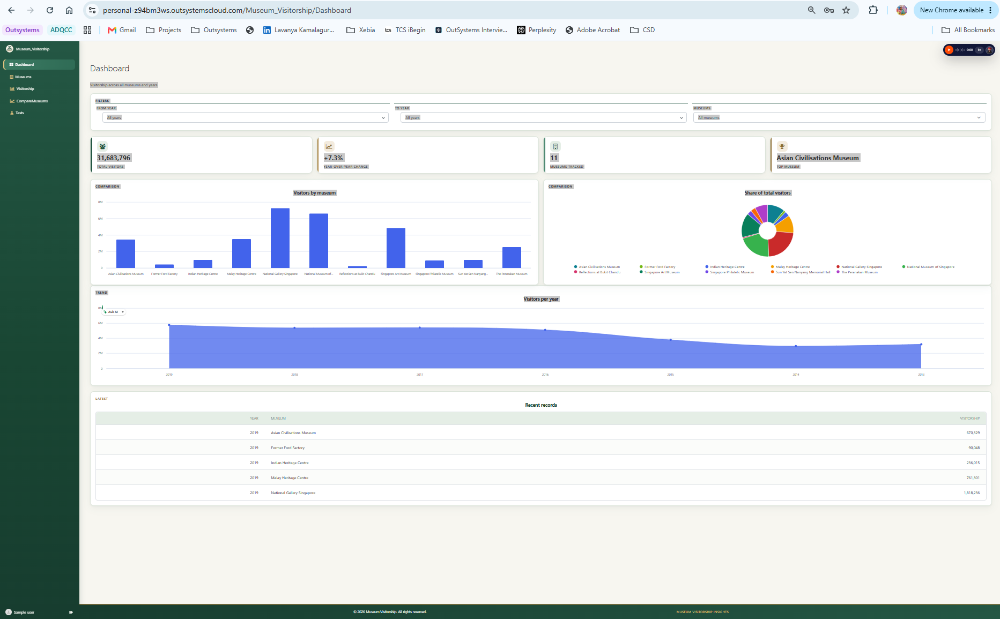
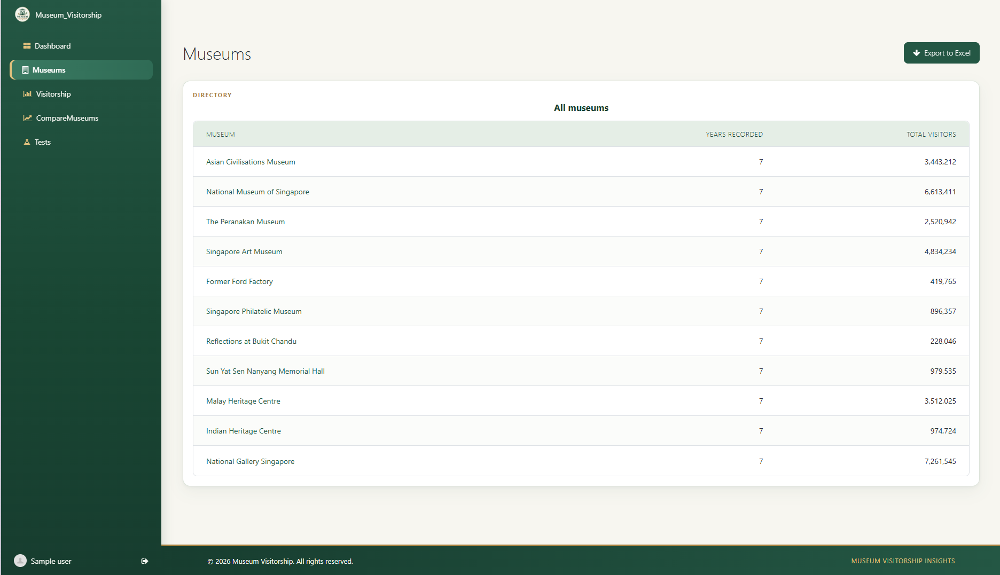
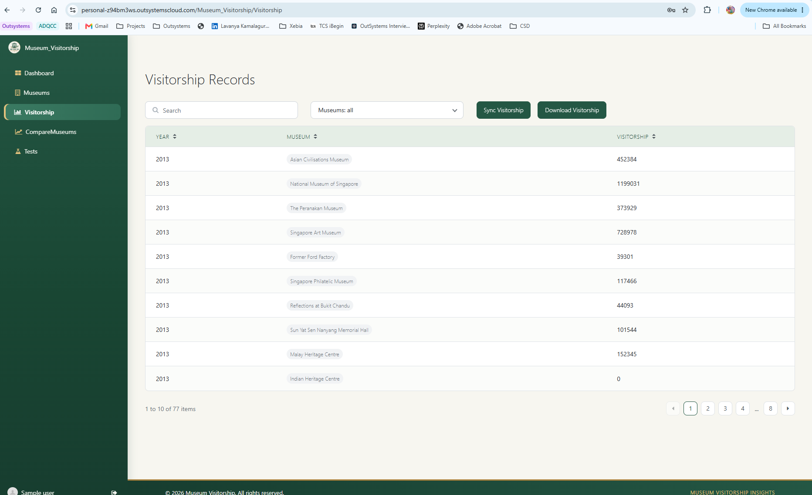
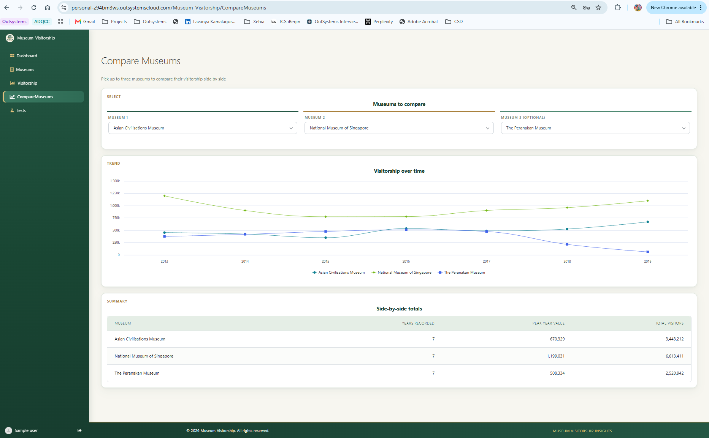
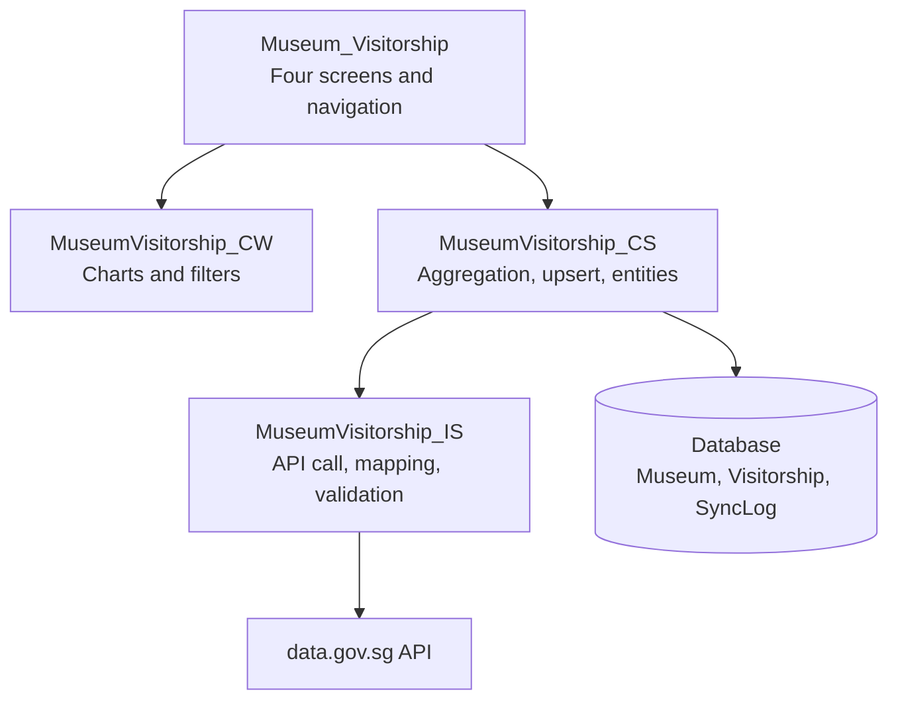
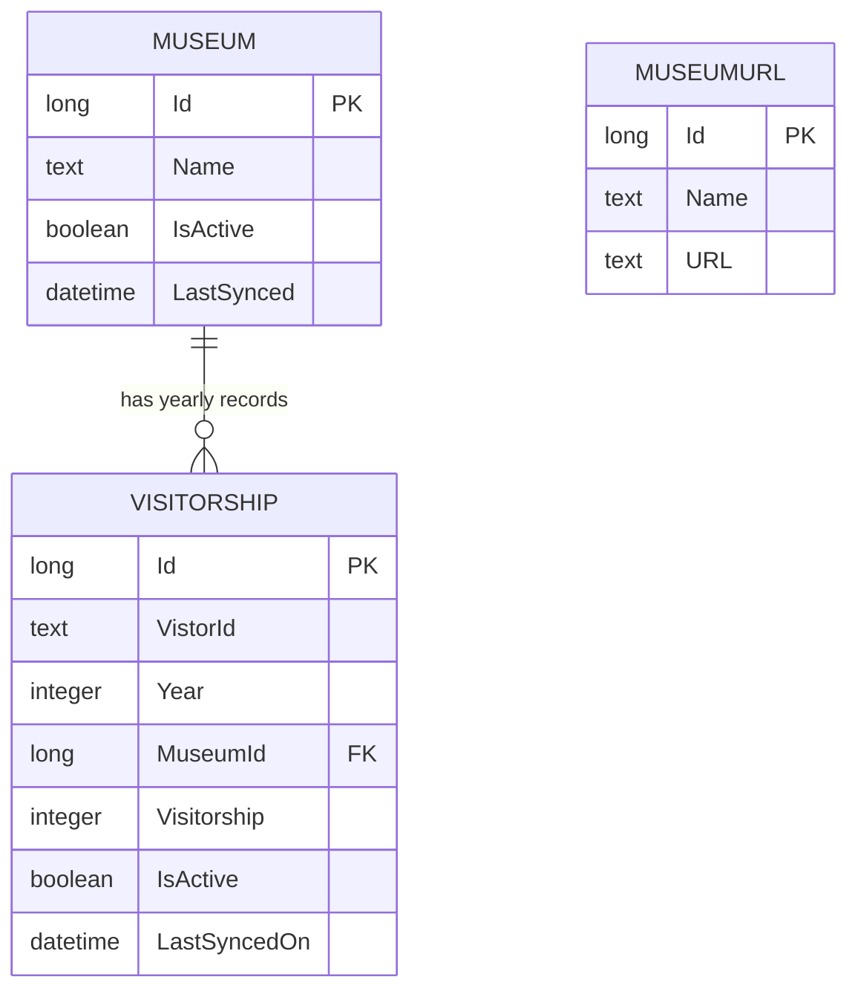

# Museum Visitorship Explorer

An OutSystems application that retrieves museum visitorship data from [data.gov.sg](https://data.gov.sg), stores it locally, and lets users explore, compare and export it. The repository also contains the Infrastructure as Code (IaC) for the AWS environment and the automated tests.


---

## Table of Contents

1. [Overview](#1-overview)
2. [Accessing the Environment](#2-accessing-the-environment)
3. [Dataset](#3-dataset)
4. [Application Screens](#4-application-screens)
5. [Architecture](#5-architecture)
6. [Data Model](#6-data-model)
7. [Data Synchronisation](#7-data-synchronisation)
8. [Design Decisions and Trade-offs](#8-design-decisions-and-trade-offs)
9. [Infrastructure as Code (AWS)](#9-infrastructure-as-code-aws)
10. [Automated Testing](#10-automated-testing)
11. [CI Pipeline](#11-ci-pipeline)
12. [Repository Structure](#12-repository-structure)
13. [Assumptions](#13-assumptions)
14. [Limitations and Next Steps](#14-limitations-and-next-steps)

---

## 1. Overview

**Goal:** turn a raw open dataset into an interface people can actually use to understand how museum visitorship changes over time.

| Requirement | Where it is addressed |
|---|---|
| Retrieve and integrate data from data.gov.sg | [Section 7](#7-data-synchronisation) |
| Clear, user-friendly interface | [Section 4](#4-application-screens) |
| Explore and interact with the data | Filters, drill-down, comparison and export ([Section 4](#4-application-screens)) |
| Sound frontend and backend design | [Sections 5, 6 and 8](#5-architecture) |
| IaC for the AWS infrastructure | [Section 9](#9-infrastructure-as-code-aws) |
| Automated testing | [Sections 10 and 11](#10-automated-testing) |

**Platform:** `[OutSystems 11 / OutSystems Developer Cloud (ODC)]`

---

## 2. Accessing the Environment

| Item | Value |
|---|---|
| Environment URL | `https://personal-z94bm3ws.outsystemscloud.com/` |
| Application URL | [Museum_Visitorship](https://personal-z94bm3ws.outsystemscloud.com/Museum_Visitorship/) |
| Reviewer account | `sampleuser@gmail.com` (123456) |
| Role | `Admin` |
| Service Studio / ODC Studio access | `Yes` |

**Steps**

1. Open the application URL.
2. Sign in with the reviewer account.
3. The data is already synchronised, so the dashboard opens populated. The last sync time is shown on `[screen / footer]`.

**Repository access:** `[how access was granted, e.g. collaborator invite sent to <email/username>]`

---

## 3. Dataset

| Item | Detail |
|---|---|
| Source | data.gov.sg |
| Dataset | `Visitorship to National Museums and Heritage Institutions`[URL](https://data.gov.sg/datasets?query=visitorship&resultId=d_618a1224b896b436ce650be1f77c804e) |
| Dataset ID / API endpoint | [URL](https://data.gov.sg/datasets?query=visitorship&resultId=d_618a1224b896b436ce650be1f77c804e) |
| Granularity | `[e.g. visitors per museum per month]` |
| Time range | `[from – to]` |
| Licence | Singapore Open Data Licence  |

**Why this dataset:** it has a clear time dimension and a natural category (museum), which supports trends, comparison and drill-down without needing any extra data.

---

## 4. Application Screens

Screenshots live in `docs/screenshots/`.

### 4.1 Dashboard

An overview with interactive filters.

- **Filters:** *From year*, *To year* and a *Museum* selector.
- **Total visitors:** a KPI for the selected range and museums.
- **Comparison by museum:** a chart of visitor totals per museum.
- **Recent records:** the latest visitorship records.
- Everything below the filters refreshes when a filter changes.



### 4.2 Museums

- A list of all museums with the years covered and total visitors.
- **Museum detail:** a chart of visitorship by year for the selected museum.



### 4.3 Visitorship

- A table of all visitorship records.
- **Download:** exports the records as `[CSV / Excel]`.



### 4.4 Compare Museums

- Compares three museums side by side on one chart.



### 4.5 UX notes

- `[Loading, empty and error states handled on each screen]`
- `[Responsive behaviour]`
- `[Accessibility: contrast, labels, keyboard navigation, if done]`




## 5. Architecture

The application is split into layers so that data access, business logic and UI can change independently.

```
┌──────────────────────────────────────────────┐
│  End-user module   (screens, filters, charts) │
├──────────────────────────────────────────────┤
│  Core Services     (business logic,           │
│                     queries, aggregation)     │
├──────────────────────────────────────────────┤
│  Integration       (REST consumption,         │
│  Service            mapping, validation)      │
├──────────────────────────────────────────────┤
│  Database          (Museum, Visitorship,      │
│                     SyncLog)                  │
└──────────────────────────────────────────────┘
         ▲
         │ scheduled / manual sync
   data.gov.sg API
```

| Module | Responsibility |
|---|---|
| `[MuseumVisitorship_IS]` | Calls the data.gov.sg API, maps and validates records |
| `[MuseumVisitorship_CS]` | Upserts data, exposes server actions for aggregation and filtering |
| `[MuseumVisitorship_CW]` | Reusable UI components (charts, filters) |
| `[Museum_Visitorship]` | The four screens and navigation |

Add a diagram image in `docs/architecture.md` if you want something more detailed than the one above.

---

## 6. Data Model


Entity	Purpose	Key attributes
- `Museum`	One row per museum	`Id`, `Name`, `IsActive`, `LastSynced`
- `Visitorship`	Visitors for one museum in one year	`Id`, `VistorId`, `Year`, `MuseumId` (FK to `Museum`), `Visitorship` (visitor count), `IsActive`, `LastSyncedOn`
- `MuseumURL`	`[Purpose, e.g. the data.gov.sg source URL for each museum, read by the sync]`	`Id`, `Name`, `URL`
Notes
- Visitorship is stored at yearly granularity.
- `IsActive` is a soft-delete flag: `[describe the rule, e.g. records no longer returned by the API are set to inactive instead of being deleted]`. Screens only show active rows.
- `LastSynced` and `LastSyncedOn` record when each row was last refreshed by the sync. The last sync time shown in the app is `[the latest value of these]`.
- `Visitorship` has a unique index on (`MuseumId`, `Year`) so the sync can safely upsert. `[Confirm this index exists.]`

## 7. Data Synchronisation

**Approach:** data is pulled from data.gov.sg and **stored in the application's own database**. The screens read from this local copy rather than calling the API on each request.

**Flow**

1. A **timer** (`[schedule]`) or the manual action triggers `SyncAll`.
2. `FetchVisitorship` calls the API (with pagination if the dataset requires it).
3. `MapToEntities` converts raw records into museums and visitorship rows, and validates them.
4. `UpsertMuseums` and `UpsertVisitorship` write the data. The sync is **idempotent**, so running it twice creates no duplicates.
5. The outcome is recorded in `SyncLog`.

**Data quality rules**

| Case | Handling |
|---|---|
| Non-numeric or empty visitor count (e.g. `na`) | `[skipped / set to 0]` and counted in the log |
| Duplicate record | Updated in place |
| API failure | Sync is marked failed, error is logged, existing data is left untouched |

---

## 8. Design Decisions and Trade-offs

| Decision | Why | Trade-off |
|---|---|---|
| Sync into local entities instead of live API calls | Fast screens, resilient to API downtime, no rate-limit exposure, allows indexing and aggregation | Data can be stale until the next sync |
| Layered modules (IS / CS / CW / app) | Clear separation of concerns, testable logic, reusable components | More modules to maintain for a small app |
| Idempotent upsert on a natural key | Safe re-runs and easy recovery | Needs a unique index and a clear key definition |
| Aggregation in server actions or aggregates | Less data sent to the client, better performance | Logic must be kept consistent with the UI filters |
| Raw API call separated from mapping logic | Mapping can be tested without network access | Slightly more actions to write |
| `[add your own]` | | |

**Security and robustness**

- `[Role-based access for any admin or sync screens]`
- `[API timeouts and retry behaviour]`
- `[Input validation on filters]`

---

## 9. Infrastructure as Code (AWS)

The IaC lives in `infrastructure/` and is written in **Terraform** `[version]`.

> **Scope note:** `[State your assumption. For example: "This provisions the AWS infrastructure for a self-managed OutSystems 11 environment. OutSystems Developer Cloud is operated by OutSystems on AWS, so the resources below apply to the self-managed model."]`

### 9.1 What it provisions

| Area | Resources |
|---|---|
| Network | VPC, public and private subnets across 2 AZs, internet and NAT gateways, route tables, security groups |
| Compute | `[EC2 front-end servers in an Auto Scaling group]`, `[deployment controller instance]` |
| Load balancing | Application Load Balancer with HTTPS (ACM certificate) |
| Database | RDS `[SQL Server]`, multi-AZ in production |
| Storage | S3 buckets for logs and backups |
| Security | IAM roles and policies, Secrets Manager for credentials |
| Observability | CloudWatch log groups and alarms |

### 9.2 Layout

```
infrastructure/
├── main.tf
├── variables.tf
├── outputs.tf
├── versions.tf
├── modules/
│   ├── network/
│   ├── compute/
│   ├── database/
│   └── monitoring/
└── environments/
    ├── dev.tfvars.example
    └── prod.tfvars.example
```

### 9.3 Usage

```bash
cd infrastructure
terraform init
terraform fmt -check
terraform validate
terraform plan -var-file=environments/dev.tfvars
```

- Copy `*.tfvars.example` to `*.tfvars` and fill in values. Real `tfvars` files are git-ignored.
- State: `[remote state in S3 with DynamoDB locking, or local for this exercise]`.
- `[State whether you applied it or only validated and planned]`.

### 9.4 Design notes

- **Availability:** resources span two availability zones.
- **Security:** the database and application servers sit in private subnets, and only the load balancer is public. Secrets are not stored in code.
- **Scaling:** `[Auto Scaling policy]`.
- **Cost:** `[main cost drivers and how dev differs from prod]`.

---

## 10. Automated Testing

### 10.1 Strategy

| Layer | Tool | What is covered |
|---|---|---|
| Application logic | OutSystems **BDD Framework** `[or the approach used]` | Mapping, upsert, idempotency, error handling, aggregation |
| Infrastructure | `terraform fmt`, `terraform validate`, `tflint`, `checkov` `[and Terratest if used]` | Syntax, lint, security misconfiguration |
| Pipeline | GitHub Actions | Runs the IaC checks on every push |

The live API call is deliberately **not** unit-tested. Tests feed canned sample records into the mapping and upsert logic so they are fast and deterministic.

### 10.2 Test data

- Sample records are stored in `[constant / static entity]` in `Museum_Tests`.
- All test museums use the `TEST_` prefix. A `Test_Cleanup` action removes them at the start of every scenario so scenarios are independent.

### 10.3 Scenarios

| # | Scenario | Given | When | Then |
|---|---|---|---|---|
| 1 | Mapping | Raw records with museum, period and visitors | `MapToEntities` runs | Fields are mapped with correct types |
| 2 | Bad values | A record with `na` or empty visitors | `MapToEntities` runs | Row is handled per the rule and no exception is raised |
| 3 | Idempotent sync | Data already synced once | The same data is synced again | Row counts are unchanged |
| 4 | Update | An existing row with a different count | Sync runs | The count is updated, not duplicated |
| 5 | API failure | The fetch step fails | `SyncAll` runs | Status is failed, error is logged, existing data is intact |
| 6 | Aggregation | Known test rows | The total action runs | The total equals the hand-calculated sum |
| 7 | `[Filter by year range]` | `[...]` | `[...]` | `[...]` |
| 8 | `[Compare three museums]` | `[...]` | `[...]` | `[...]` |

### 10.4 Running the tests

**Application tests**

1. Open the BDD Framework test runner at `[URL]`.
2. Select the `[feature]` and run.
3. `[Optional: trigger via the framework's REST endpoint for CI]`.

**IaC tests**

```bash
cd infrastructure
terraform fmt -check -recursive
terraform validate
tflint
checkov -d .
```

### 10.5 Results

`[Add a screenshot or summary of the latest run. Only include results you have actually produced.]`

---

## 11. CI Pipeline

`.github/workflows/ci.yml` runs on every push and pull request:

1. `terraform fmt -check`
2. `terraform init -backend=false` and `terraform validate`
3. `tflint`
4. `checkov`

`[Describe how the OutSystems tests are run, or state that they are run manually through the test runner.]`

---

## 12. Repository Structure

```
.
├── README.md
├── docs/
│   ├── architecture.md
│   └── screenshots/
├── outsystems/              # exported application and test modules
├── infrastructure/          # Terraform
├── tests/
│   ├── outsystems/          # scenario descriptions, test module export
│   └── iac/
└── .github/workflows/
```

---

## 13. Assumptions

- `[Platform: O11 or ODC, and what that means for the IaC]`
- `[The dataset is refreshed on a cadence that makes a scheduled sync appropriate]`
- `[How missing or non-numeric values are treated]`
- `[Anything the brief left open]`

---

## 14. Limitations and Next Steps

**Limitations**

- Data is only as fresh as the last sync.
- `[IaC was validated and planned but not applied, if true]`
- `[Test coverage gaps, e.g. UI tests are not automated]`

**Next steps**

- Automated UI tests for the filters and charts.
- Alerting when a sync fails.
- Forecasting or seasonality views.
- Caching of heavy aggregations.
- `[your own ideas]`
